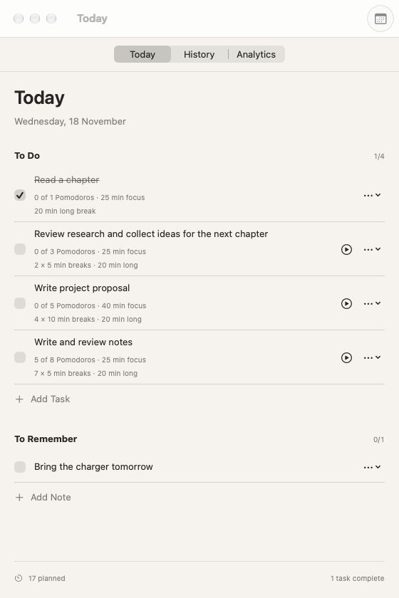
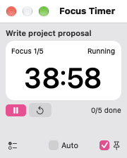
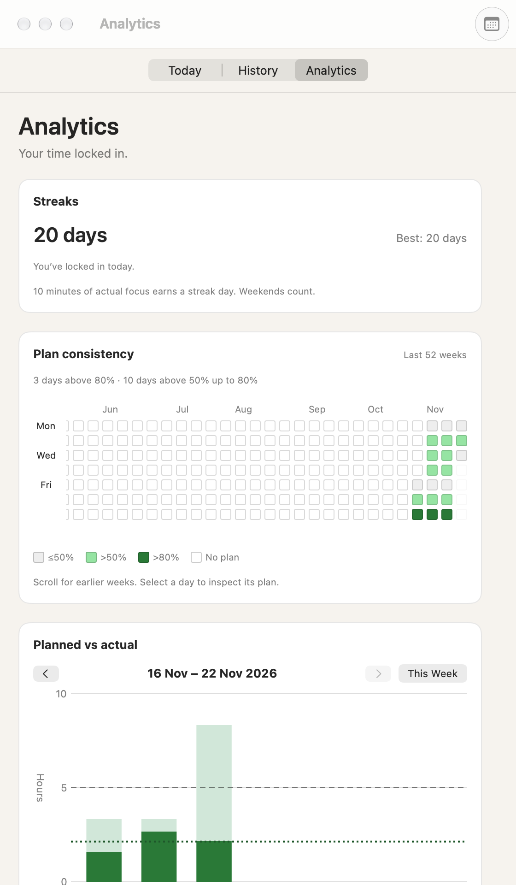

# FocusNote

A small, local-first macOS checklist and Pomodoro timer, built with SwiftUI.
**Early beta, source release:** not an App Store release or a notarized download.

[Watch the 2:33 feature walkthrough](docs/media/focusnote-demo.mp4)
([how it was made](docs/DEMO.md)). Fictional data; captioned scripted stills.

<p>
  
  
  
</p>

## Features

- **Today:** separate To Do and To Remember lists, editable task plans, completion,
  soft delete, and Undo.
- **Focus:** a resizable floating timer; pause, resume, reset, skip, and Auto mode.
  Configure focus count and focus/short-break/long-break durations per task.
  The final focus completes the task; the final break returns to your checklist.
- **Daily lists:** a new list each day with a paper-fold transition. Past lists
  remain available in read-only History; explicitly copy unfinished tasks forward.
- **Analytics:** streaks, a 52-week plan-achievement heatmap, and weekly
  planned-versus-actual focus hours with average lines and week navigation.
- **Settings:** accent colors, system-following light/dark appearance, automatic cycling, sound previews,
  and optional long breaks after early completion.
- **Sounds:** one three-beep focus burst and a short original message-style
  break ding. No Apple audio or downloaded YouTube recording is bundled.

## Build

Requires **macOS 26+**, Xcode with the macOS SDK, and **Swift 6.2+**.
There are no third-party Swift package dependencies.

```sh
git clone https://github.com/Meowplp/FocusNote.git
cd FocusNote
./build.sh
open ~/Applications/FocusNote.app
```

The script installs to `~/Applications` and uses an available Apple Development
identity or ad-hoc signing. Set `SIGN_IDENTITY=-` to choose ad-hoc explicitly.
`./build.sh --open` quits/reopens a running copy: **finish your timer first**.
Icon compilation requires Xcode command-line tools; see `tools/make_icon.sh`.

## Privacy and data

Tasks and timer history live in
`~/Library/Application Support/FocusNote/FocusNote.store` (with SQLite sidecars).
The app has no networking code, telemetry, accounts, or cloud synchronization.
It does not request Screen Recording access: previews render only its own views.
Audio is output-only. The database is not separately encrypted; protect your Mac
account and use FileVault as appropriate.

Quit the app before backing up the **whole FocusNote data directory**.
Export/sync are not implemented. Do not rely on a beta as your only copy of
important tasks.

## Verify

```sh
swift test --scratch-path ~/Library/Developer/FocusNote/test-build
tools/selftest.sh
tools/check-migration.sh
tools/check-no-screen-recording.sh
python3 tools/check-automation-safety.py
tools/snap.sh
```

Self-tests and snapshots use a separately identified Preview app and private
temporary storage. Snapshot paths are printed at completion. No personal data
is used. `FOCUSNOTE_AUDIBLE_TEST=1 tools/selftest.sh` plays both sounds aloud.

See [architecture](ARCHITECTURE.md), [timer checks](docs/TIMER-CHECKS.md),
and [security guidance](SECURITY.md).

## Limitations

Physical sleep/wake, multiple monitors/full-screen, and a full VoiceOver audit
still need broader manual testing. This source build is not sandboxed,
notarized, or prepared for App Store submission.

## License

[MIT](LICENSE). Apple frameworks and SF Symbols remain subject to Apple's terms.
